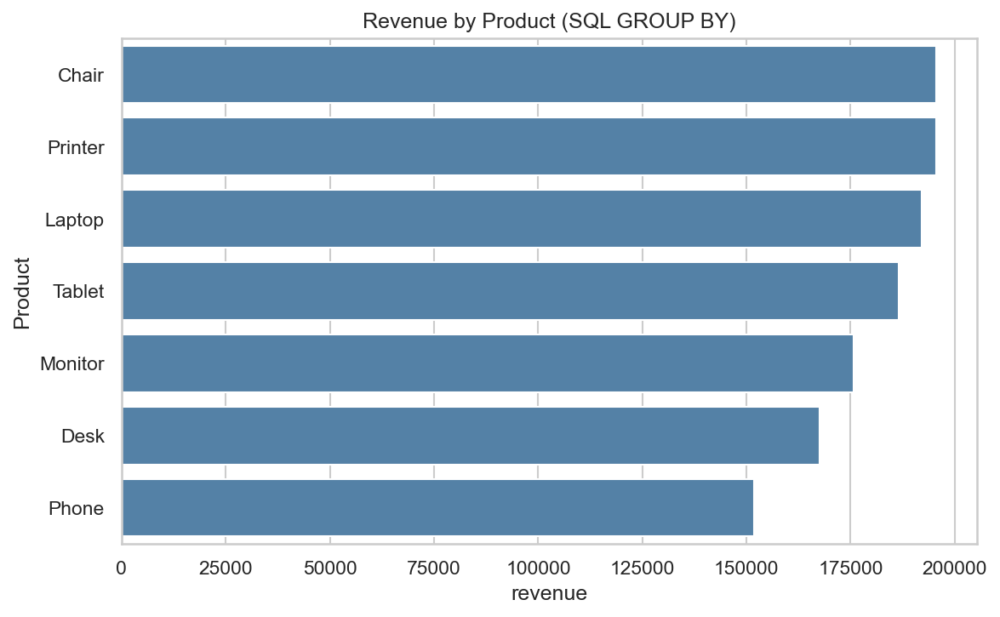
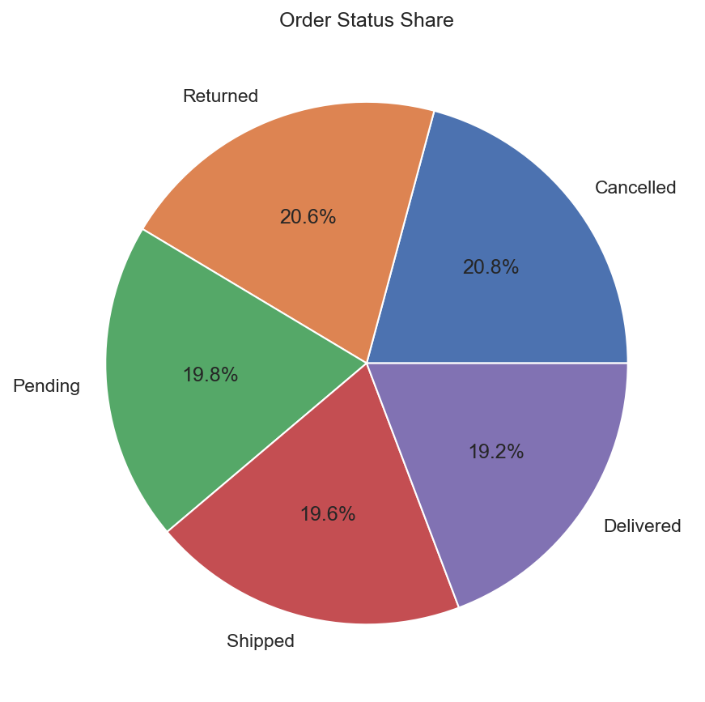
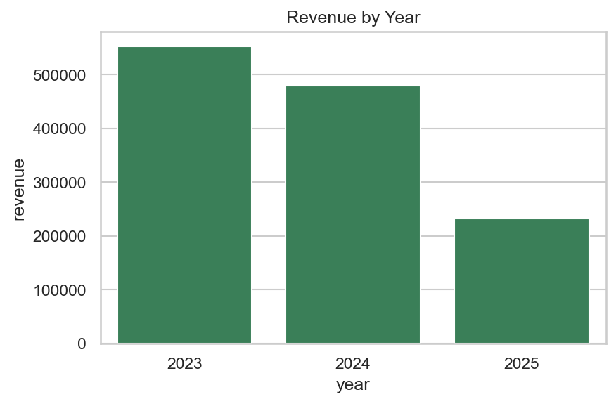

# Project 3: SQL Data Analysis | DecodeLabs Data Analytics Internship

## Overview
SQL analysis of 1,200 e-commerce orders (Jan 2023 – Jun 2025). The data is loaded into an SQLite database and queried with `SELECT`, `WHERE`, `ORDER BY`, `GROUP BY`, `HAVING`, aggregations (`COUNT`, `SUM`, `AVG`), subqueries and `CASE WHEN` to answer business questions.

## Business Questions Answered
- How big is the business (orders, revenue, average order value)?
- Which products generate the most revenue?
- How many orders are cancelled or returned?
- Is revenue growing or declining year over year?
- Do coupons, referral sources or payment methods affect order value?
- Are customers coming back?

## Key Findings
- 1,200 orders, total revenue **1,264,762**, average order value **1,053.97**
- **41.4%** of orders are Cancelled or Returned (about 519.7k in order value)
- Jan–Jun revenue fell about **10% each year**: 286.5k (2023) → 257.1k (2024) → 231.9k (2025)
- Printer and Chair lead with **15.5%** of revenue each; Phone is lowest at **12.0%**
- Only **1,189 unique customers** for 1,200 orders, so almost no repeat buyers
- Failure rate is similar across products (39.4% – 43.6%), so the issue is company-wide

## SQL Concepts Used
| Concept | Example |
|---------|---------|
| Filtering | `WHERE`, `AND`, `IN`, `BETWEEN`, `LIKE` |
| Sorting | `ORDER BY ... DESC`, `LIMIT` |
| Aggregation | `COUNT`, `SUM`, `AVG`, `MIN`, `MAX` |
| Grouping | `GROUP BY`, `HAVING` |
| Advanced | Subqueries, `CASE WHEN`, `strftime()` for dates |

## Tools
Python, SQLite, Pandas, Matplotlib, Seaborn

## Project Structure
```
├── SQL_Project3.ipynb # Main notebook (queries + charts)
├── Cleaned_Dataset.xlsx # Source data
├── images/ # Saved charts
├── requirements.txt
└── README.md
```

## How to Run
```bash
pip install -r requirements.txt
jupyter notebook SQL_Project3.ipynb
```

## Sample Visuals











## Author
Nasir Ali | Data Analytics Intern, DecodeLabs (Batch 2026)
